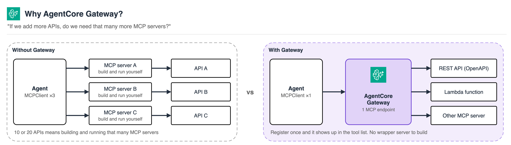
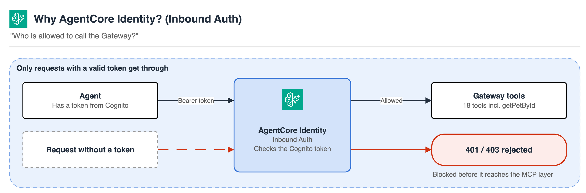
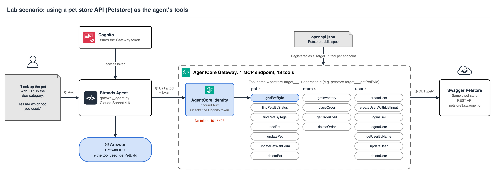
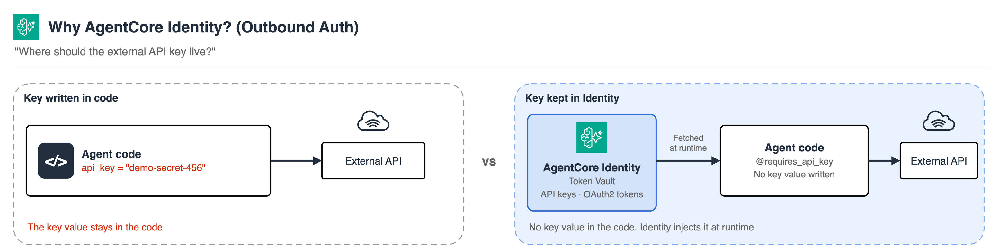

# 9. Connecting External APIs and Controlling Access (AgentCore Gateway & Identity)

<p align="center"><a href="../../ko/09-agentcore-gateway-identity/README.md">한국어</a> | <a href="README.md">English</a></p>

## Table of Contents

- [What is AgentCore Gateway?](#what-is-agentcore-gateway)
- [What is AgentCore Identity?](#what-is-agentcore-identity)
- [0. Overview of the Full Flow](#0-overview-of-the-full-flow)
- [1. Setting Up the Gateway (Cognito + IAM + Gateway + Target)](#1-setting-up-the-gateway-cognito--iam--gateway--target)
- [2. Getting a Token and Calling the Gateway from an Agent](#2-getting-a-token-and-calling-the-gateway-from-an-agent)
- [3. (Optional) Outbound Auth: Authenticating Safely to External APIs](#3-optional-outbound-auth-authenticating-safely-to-external-apis)
- [Cleanup](#cleanup)
- [Troubleshooting](#troubleshooting)

---

In this lab, you'll learn how an agent can call an **external API as an MCP tool**, and how to **control who is allowed to make that call**. You'll use [Amazon Bedrock AgentCore Gateway](https://docs.aws.amazon.com/bedrock-agentcore/latest/devguide/gateway.html) to expose an existing REST API as MCP tools, and [AgentCore Identity](https://docs.aws.amazon.com/bedrock-agentcore/latest/devguide/identity.html) to restrict who can call that Gateway using a Cognito-issued OAuth2 token.

The lab format is the same as other chapters: write code directly into the empty files under `labs/`, and `completed/` holds the reference implementation.

> [!NOTE]
> **Prerequisites**
> - Environment set up and the uv environment activated, following [00-setup](../00-setup/README.md)
> - As in previous chapters, Amazon Bedrock model (Claude) access enabled in the `us-west-2` region
> - Permissions for IAM (create role), Cognito (create user pool), and Bedrock AgentCore (create Gateway)
> - This chapter creates **billable AWS resources** (an AgentCore Gateway, a Cognito User Pool). Both are low-cost, but make sure to run [cleanup](#cleanup) when you're done.

**What you'll learn in this chapter**

- How AgentCore Gateway turns a REST API, Lambda function, or other MCP server into MCP tools
- The difference between AgentCore Identity's Inbound Auth (who can call the Gateway) and Outbound Auth (how the agent authenticates to external services)
- How to configure a Gateway's Inbound Auth (Custom JWT Authorizer) with a Cognito User Pool
- How to create a Gateway with boto3 and register a public OpenAPI spec (Swagger Petstore) as a Target
- How a Strands agent calls the Gateway's MCP tools using an issued OAuth2 token
- (Optional) The concept and code pattern for Outbound Auth Credential Providers (API Key, OAuth2)

**Estimated time:** about 25 minutes

## Files in This Chapter

| File | Purpose |
|---|---|
| `labs/setup_gateway.py` | (empty) Write yourself: create Cognito + the IAM role + the Gateway + the Petstore OpenAPI Target |
| `labs/gateway_agent.py` | (empty) Write yourself: get a token and run a Strands agent that uses the Gateway as a tool |
| `labs/outbound_auth_demo.py` | (empty, optional) Write yourself: Identity Outbound Auth (API Key) demo |
| `labs/cleanup.py` | (empty) Write yourself: cleanup script |
| `completed/*.py` | Reference implementation |

---

## What is AgentCore Gateway?

Gateway is a fully managed service that **turns REST APIs (OpenAPI specs), Lambda functions, or other MCP servers into MCP tools**. As you saw in [chapter 1-3](../01-single-agent/README.md), the default pattern is one MCP Client per MCP Server. Once a company has 10 or 20 APIs, that means running and maintaining that many MCP Servers. Gateway lets you register all of those backends and have them served through a single MCP endpoint. The agent's Client only needs to connect to one Gateway endpoint to receive the combined tool list from every backend registered behind it.

In this lab, you'll register the OpenAPI spec of the public Swagger Petstore (a sample pet-store API) as a Target. The moment you register it, each endpoint of that API (`getPetById`, `addPet`, and so on) is automatically mapped to an MCP tool. There's no need to write new code or build a wrapper server for the API.



## What is AgentCore Identity?

Identity is responsible for two things.

- **Inbound Auth**: verifies "who is allowed to call" a Gateway or Runtime. In this lab, only clients holding a JWT token issued by a Cognito User Pool will be allowed to call the Gateway.
- **Outbound Auth**: manages "how the agent authenticates to external services." Instead of embedding API keys or OAuth2 tokens directly in agent code, you register them in Identity's Token Vault, and the agent retrieves them securely at runtime.



Steps 1 through 2 of this lab set up and exercise Inbound Auth directly. Step 3 exercises Outbound Auth hands-on.

## 0. Overview of the Full Flow



```
Cognito User Pool (Inbound Auth issuer)
        │ discovery URL, client_id, client_secret
        ▼
Create Gateway (authorizerType=CUSTOM_JWT connected to the Cognito above)
        │
        ▼
Register an OpenAPI Target on the Gateway (Petstore spec -> auto-mapped to MCP Tools)
        │
        ▼
Client requests an OAuth2 access token from Cognito (client_credentials)
        │
        ▼
Strands agent calls the Gateway's MCP tools, with that token in the Authorization header
```

Step 1 is "setting up the Gateway," step 2 is "using that Gateway."

## 1. Setting Up the Gateway (Cognito + IAM + Gateway + Target)

Cognito setup, IAM role creation, Gateway creation, and OpenAPI Target registration all happen in one script, run in order.

**1-1.** Open `labs/setup_gateway.py`.

**1-2.** Import the libraries you'll need, and define constants.

```py
import json
import secrets
import string
import time

import boto3
import requests

REGION = "us-west-2"
POOL_NAME = "agentcore-workshop-gateway-pool"
RESOURCE_SERVER_ID = "gateway"
SCOPE_NAME = "invoke"
APP_CLIENT_NAME = "agentcore-workshop-gateway-client"
ROLE_NAME = "agentcore-workshop-gateway-role"
GATEWAY_NAME = "petstore-gateway"
TARGET_NAME = "petstore-target"
PETSTORE_OPENAPI_URL = "https://petstore3.swagger.io/api/v3/openapi.json"
CONFIG_FILE = "gateway_config.json"
```

**1-3.** Write a function that creates the Cognito resources: a User Pool, a Resource Server (defining the `gateway/invoke` scope), an App Client using the `client_credentials` flow, and a domain for the token endpoint. This setup decides "who can call the Gateway" (Inbound Auth). If a User Pool with the same name already exists (you re-ran the script), it's deleted and recreated so the client secret you get below is always current.

```py
def random_suffix(n: int = 6) -> str:
    return "".join(secrets.choice(string.ascii_lowercase + string.digits) for _ in range(n))


def setup_cognito() -> dict:
    print("1) Setting up Cognito (User Pool, Resource Server, App Client, domain)...")
    cognito = boto3.client("cognito-idp", region_name=REGION)

    # Re-running this script should not pile up duplicate pools: reuse one if it exists.
    existing = [p for p in cognito.list_user_pools(MaxResults=60)["UserPools"] if p["Name"] == POOL_NAME]
    for pool in existing:  # start clean so the client secret below is fresh
        old_domain = cognito.describe_user_pool(UserPoolId=pool["Id"])["UserPool"].get("Domain")
        if old_domain:
            cognito.delete_user_pool_domain(Domain=old_domain, UserPoolId=pool["Id"])
        cognito.delete_user_pool(UserPoolId=pool["Id"])
    user_pool_id = cognito.create_user_pool(PoolName=POOL_NAME)["UserPool"]["Id"]

    cognito.create_resource_server(
        UserPoolId=user_pool_id,
        Identifier=RESOURCE_SERVER_ID,
        Name="AgentCore Gateway Resource Server",
        Scopes=[{"ScopeName": SCOPE_NAME, "ScopeDescription": "Invoke gateway tools"}],
    )
    full_scope = f"{RESOURCE_SERVER_ID}/{SCOPE_NAME}"

    app_client = cognito.create_user_pool_client(
        UserPoolId=user_pool_id,
        ClientName=APP_CLIENT_NAME,
        GenerateSecret=True,
        AllowedOAuthFlows=["client_credentials"],
        AllowedOAuthScopes=[full_scope],
        AllowedOAuthFlowsUserPoolClient=True,
        SupportedIdentityProviders=["COGNITO"],
    )

    domain = f"agentcore-ws-{random_suffix()}"
    cognito.create_user_pool_domain(Domain=domain, UserPoolId=user_pool_id)

    return {
        "user_pool_id": user_pool_id,
        "client_id": app_client["UserPoolClient"]["ClientId"],
        "client_secret": app_client["UserPoolClient"]["ClientSecret"],
        "domain": domain,
        "discovery_url": (
            f"https://cognito-idp.{REGION}.amazonaws.com/{user_pool_id}"
            "/.well-known/openid-configuration"
        ),
        "token_endpoint": f"https://{domain}.auth.{REGION}.amazoncognito.com/oauth2/token",
        "scope": full_scope,
    }
```

> **What is the `client_credentials` flow?**
> Unlike the flow where a person types a username/password into a login screen (Authorization Code), this is an M2M (machine-to-machine) flow where a server or script gets a token purely by proving its own identity (client_id + client_secret). The agent in this lab doesn't need to act "on behalf of a specific user" -- it only needs to prove it's a client allowed to call the Gateway, so this flow is a good fit.

**1-4.** Write a function that creates the IAM role the Gateway will use to call the Petstore API and write logs.

```py
def setup_gateway_role() -> str:
    print("2) Creating the IAM role the Gateway will use...")
    iam = boto3.client("iam", region_name=REGION)
    account_id = boto3.client("sts", region_name=REGION).get_caller_identity()["Account"]

    trust_policy = {
        "Version": "2012-10-17",
        "Statement": [{
            "Effect": "Allow",
            "Principal": {"Service": "bedrock-agentcore.amazonaws.com"},
            "Action": "sts:AssumeRole",
            "Condition": {"StringEquals": {"aws:SourceAccount": account_id}},
        }],
    }
    # Minimal permissions for this workshop. Scope resources down further for production use.
    permissions_policy = {
        "Version": "2012-10-17",
        "Statement": [{
            "Effect": "Allow",
            "Action": [
                "bedrock-agentcore:*",
                "secretsmanager:GetSecretValue",
                "logs:CreateLogGroup",
                "logs:CreateLogStream",
                "logs:PutLogEvents",
            ],
            "Resource": "*",
        }],
    }

    try:
        role_arn = iam.create_role(
            RoleName=ROLE_NAME,
            AssumeRolePolicyDocument=json.dumps(trust_policy),
            Description="AgentCore Gateway workshop execution role",
        )["Role"]["Arn"]
    except iam.exceptions.EntityAlreadyExistsException:
        role_arn = iam.get_role(RoleName=ROLE_NAME)["Role"]["Arn"]

    iam.put_role_policy(
        RoleName=ROLE_NAME,
        PolicyName="agentcore-workshop-gateway-policy",
        PolicyDocument=json.dumps(permissions_policy),
    )
    time.sleep(10)  # let the new role propagate
    return role_arn
```

**1-5.** Creating a Gateway and a Target isn't instantaneous -- each goes through a `CREATING` state before becoming `READY`. Write one shared function that waits for either, so you don't need to duplicate the polling logic.

```py
def wait_until(describe_fn) -> dict:
    """Polls describe_fn() until its 'status' field is READY (or raises on failure)."""
    while True:
        resp = describe_fn()
        status = resp["status"]
        if status == "READY":
            return resp
        if status in ("FAILED", "UPDATE_UNSUCCESSFUL", "SYNCHRONIZE_UNSUCCESSFUL"):
            raise RuntimeError(f"Failed with status {status}: {resp.get('statusReasons')}")
        time.sleep(5)
```

**1-6.** Write a function that creates the Gateway and registers Petstore's public OpenAPI spec as a Target.

- Set `authorizerType="CUSTOM_JWT"` and pass the Cognito information from 1-3 straight into `authorizerConfiguration`. This is the Inbound Auth rule: "only let through tokens issued by this Cognito, with this client_id." (You can also enforce the scope with `allowedScopes`, but that field was added fairly recently and isn't supported by every botocore version, so this lab leaves it out.)
- The public Petstore spec can't be used as-is -- it needs two fixes. `servers` is a relative path like `/api/v3`, but the Gateway requires an absolute HTTPS URL, and the `/pet/{petId}/uploadImage` endpoint uses an `application/octet-stream` request body that the Gateway's OpenAPI importer doesn't support.
- Gateway and Target names must be unique within the account. Re-running the script raises `ConflictException`, so in that case we look up the existing one and reuse it, updating only the Gateway's Cognito settings. If a run fails halfway, just run it again.
- Don't set `credentialProviderConfigurations` at all. `GATEWAY_IAM_ROLE` is meant for AWS services the Gateway signs requests to with SigV4 -- for a public API like Petstore that needs no auth whatsoever, just omit the parameter.

```py
def setup_gateway_and_target(cognito_info: dict, role_arn: str) -> dict:
    client = boto3.client("bedrock-agentcore-control", region_name=REGION)

    print("3) Creating the Gateway (Inbound Auth: Cognito JWT) and waiting for it to be READY...")
    authorizer = {
        "customJWTAuthorizer": {
            "discoveryUrl": cognito_info["discovery_url"],
            "allowedClients": [cognito_info["client_id"]],
        }
    }
    try:
        gateway_id = client.create_gateway(
            name=GATEWAY_NAME,
            roleArn=role_arn,
            protocolType="MCP",
            authorizerType="CUSTOM_JWT",
            authorizerConfiguration=authorizer,
            description="Workshop: Gateway exposing the Petstore OpenAPI as MCP tools",
        )["gatewayId"]
    except client.exceptions.ConflictException:
        # Left over from an earlier run: reuse it, but point it at the Cognito pool we just made.
        gateway_id = next(g["gatewayId"] for g in client.list_gateways()["items"] if g["name"] == GATEWAY_NAME)
        print(f"   Gateway '{GATEWAY_NAME}' already exists ({gateway_id}), reusing it.")
        wait_until(lambda: client.get_gateway(gatewayIdentifier=gateway_id))
        client.update_gateway(
            gatewayIdentifier=gateway_id,
            name=GATEWAY_NAME,
            roleArn=role_arn,
            protocolType="MCP",
            authorizerType="CUSTOM_JWT",
            authorizerConfiguration=authorizer,
        )
    gateway_url = wait_until(lambda: client.get_gateway(gatewayIdentifier=gateway_id))["gatewayUrl"]

    print("4) Registering the Petstore OpenAPI as a Target and waiting for it to be READY...")
    spec = requests.get(PETSTORE_OPENAPI_URL, timeout=30).json()
    spec["servers"] = [{"url": "https://petstore3.swagger.io/api/v3"}]
    spec["paths"].pop("/pet/{petId}/uploadImage", None)

    try:
        target_id = client.create_gateway_target(
            gatewayIdentifier=gateway_id,
            name=TARGET_NAME,
            targetConfiguration={"mcp": {"openApiSchema": {"inlinePayload": json.dumps(spec)}}},
            description="Public Swagger Petstore API",
        )["targetId"]
    except client.exceptions.ConflictException:
        target_id = next(
            tg["targetId"]
            for tg in client.list_gateway_targets(gatewayIdentifier=gateway_id)["items"]
            if tg["name"] == TARGET_NAME
        )
        print(f"   Target '{TARGET_NAME}' already exists ({target_id}), reusing it.")
    wait_until(lambda: client.get_gateway_target(gatewayIdentifier=gateway_id, targetId=target_id))

    return {"gateway_id": gateway_id, "gateway_url": gateway_url, "target_id": target_id}
```

**1-7.** Write the entry point that runs all three functions in order, and saves the results to `gateway_config.json`. The agent script and the cleanup script in the next steps both read from this file.

```py
if __name__ == "__main__":
    cognito_info = setup_cognito()
    role_arn = setup_gateway_role()
    gateway_info = setup_gateway_and_target(cognito_info, role_arn)

    config = {**cognito_info, "role_arn": role_arn, "region": REGION, **gateway_info}
    with open(CONFIG_FILE, "w") as f:
        json.dump(config, f, indent=2)

    print(f"\nDone! Gateway URL: {config['gateway_url']}")
```

**1-8.** Run it from the terminal.

```bash
cd 09-agentcore-gateway-identity/labs
uv run setup_gateway.py
cd -
```

Success looks like four logged steps in order, ending with a Gateway URL like `https://<gateway-id>.gateway.bedrock-agentcore.us-west-2.amazonaws.com/mcp`. This usually takes 1-2 minutes.

<details>
<summary>See the full code (setup_gateway.py)</summary>

The full code is in `09-agentcore-gateway-identity/completed/setup_gateway.py`.
</details>

## 2. Getting a Token and Calling the Gateway from an Agent

**2-1.** Open `labs/gateway_agent.py`.

**2-2.** Import the libraries, and load the config file.

```py
import json

import requests
from mcp.client.streamable_http import streamablehttp_client
from strands import Agent
from strands.models import BedrockModel
from strands.tools.mcp import MCPClient

CONFIG_FILE = "gateway_config.json"

with open(CONFIG_FILE) as f:
    config = json.load(f)
```

**2-3.** Write a function that requests a `client_credentials` token from the Cognito token endpoint.

```py
def get_access_token() -> str:
    """Gets an OAuth2 access token from Cognito (client_credentials flow).
    This token goes into the Authorization header when calling the Gateway."""
    response = requests.post(
        config["token_endpoint"],
        data={
            "grant_type": "client_credentials",
            "client_id": config["client_id"],
            "client_secret": config["client_secret"],
            "scope": config["scope"],
        },
        headers={"Content-Type": "application/x-www-form-urlencoded"},
        timeout=30,
    )
    response.raise_for_status()
    return response.json()["access_token"]
```

**2-4.** The structure is exactly the same as connecting a local MCP server with `stdio_client` in [chapter 1-3](../01-single-agent/README.md) -- only the connection target changes, from a local process to a remote Gateway URL. Putting the access token in `streamablehttp_client`'s `headers` as `Authorization: Bearer <token>` is what gets you past Inbound Auth.

```py
access_token = get_access_token()

gateway_mcp_client = MCPClient(lambda: streamablehttp_client(
    config["gateway_url"],
    headers={"Authorization": f"Bearer {access_token}"},
))

if __name__ == "__main__":
    user_input = (
        "Look up the pet with ID 1 in the dog category. "
        "Tell me which tool you used."
    )

    bedrock_model = BedrockModel(model_id="us.anthropic.claude-sonnet-4-6")

    agent = Agent(model=bedrock_model, tools=[gateway_mcp_client])
    response = agent(user_input)
```

**2-5.** Run it.

```bash
cd 09-agentcore-gateway-identity/labs
uv run gateway_agent.py
cd -
```

You should see the agent pick one of the tools the Gateway returned, call it, and answer based on the result. Tool names are auto-generated as `<Target name>___<operationId>`, for example `petstore-target___getPetById`.

<details>
<summary>What happens if you call it without a token?</summary>

If you remove `headers` and run it, you'll get a `401` or `403` error. Because the Gateway is set to `authorizerType=CUSTOM_JWT`, a request without a valid token is rejected before it even reaches the MCP protocol layer. This is exactly where Inbound Auth does its job.
</details>

<details>
<summary>See the full code (gateway_agent.py)</summary>

The full code is in `09-agentcore-gateway-identity/completed/gateway_agent.py`.
</details>

Congratulations! You've exposed an external API as an MCP tool through the Gateway, and controlled who can call it with a Cognito-based token.

## 3. (Optional) Outbound Auth: Authenticating Safely to External APIs

> [!NOTE]
> This section is **optional**. It doesn't affect the core workshop flow, and you can skip ahead to the next chapter.

So far, `GATEWAY_IAM_ROLE` was enough because Petstore is a public API that needs no auth. In practice, the API you want to register as a Target often requires its own API key or OAuth2 token. Instead of hardcoding that credential in your code, registering it in Identity's **Credential Provider** is what Outbound Auth is for.



Steps 1-2 handled "who can call the Gateway" (Inbound Auth) through Gateway settings. This step works directly with "how the agent authenticates to external services" (Outbound Auth) using the `bedrock_agentcore.identity` library.

**4-1.** Open `labs/outbound_auth_demo.py`.

**4-2.** Import the libraries and define constants. Explicitly set the `AWS_REGION` environment variable that `requires_api_key` reads internally, to match the region you've been creating resources in.

```py
import json
import os

import boto3
from bedrock_agentcore.identity import requires_api_key

REGION = "us-west-2"
PROVIDER_NAME = "workshop-weather-api-key-provider"
WORKLOAD_IDENTITY_NAME = "workshop-outbound-auth-identity"

# requires_api_key() below reads AWS_REGION to decide which region to call.
# Force it to match the region we create resources in, in case the shell
# has a different AWS_REGION/AWS_DEFAULT_REGION already set.
os.environ["AWS_REGION"] = REGION
```

**4-3.** Write a function that registers an API key with Identity, and pre-provisions the Workload Identity used to retrieve it. Both names must be unique within the account, so a re-run raises an `already exists` error; in that case we simply reuse the existing ones.

> **Why pre-provision the Workload Identity?**
> The `requires_api_key` decorator can create a Workload Identity automatically if one doesn't exist. That auto-create path isn't supported yet outside of AgentCore Runtime (like running locally, as we're doing here). So we create it ahead of time through the control plane API, save its name to `.agentcore.json`, and the decorator picks up that config instead.

```py
def register_demo_credential() -> None:
    client = boto3.client("bedrock-agentcore-control", region_name=REGION)

    print("1) Registering a sample API key with Identity...")
    try:
        client.create_api_key_credential_provider(name=PROVIDER_NAME, apiKey="demo-secret-456")
    except client.exceptions.ValidationException as e:
        if "already exists" not in str(e):
            raise
        print(f"   Provider '{PROVIDER_NAME}' already exists, reusing it.")

    print("2) Pre-provisioning the workload identity...")
    try:
        client.create_workload_identity(name=WORKLOAD_IDENTITY_NAME, allowedResourceOauth2ReturnUrls=[])
    except (client.exceptions.ConflictException, client.exceptions.ValidationException) as e:
        if "already exists" not in str(e).lower():
            raise
        print(f"   Workload identity '{WORKLOAD_IDENTITY_NAME}' already exists, reusing it.")

    with open(".agentcore.json", "w") as f:
        json.dump(
            {"workload_identity_name": WORKLOAD_IDENTITY_NAME, "user_id": "workshop-user"},
            f,
            indent=2,
        )
    print("Done.")
```

**4-4.** Write a function that uses the `requires_api_key` decorator to retrieve that key. Notice that the actual key value doesn't appear anywhere in this function's code.

```py
@requires_api_key(provider_name=PROVIDER_NAME)
def call_weather_api(*, api_key: str) -> None:
    """Stands in for a call to a real external weather API. This function
    never hardcodes the key -- requires_api_key fetches it from Identity's
    Token Vault and injects it here."""
    print(f"Calling the weather API with a key that starts with '{api_key[:4]}...'")
    print("(This is a demo -- no real external API is actually called.)")


if __name__ == "__main__":
    register_demo_credential()
    call_weather_api()
```

**4-5.** Run it.

```bash
cd 09-agentcore-gateway-identity/labs
uv run outbound_auth_demo.py
cd -
```

Success looks like a line showing just the first few characters of the key, like `Calling the weather API with a key that starts with 'demo...'`. The key you registered (`demo-secret-456`) in `register_demo_credential()` was never written again in code -- it was pulled straight out of Identity's Token Vault.

<details>
<summary>See the full code (outbound_auth_demo.py)</summary>

The full code is in `09-agentcore-gateway-identity/completed/outbound_auth_demo.py`.
</details>

**If you want to wire an API key straight into a Gateway Target**

Here you fetched the key directly in agent code. If the API you're registering as a Target itself requires an API key, you can instead have the Gateway pull that key out and attach it to the header for you. Add this to `credentialProviderConfigurations` in your `create_gateway_target` call.

```py
import boto3

client = boto3.client("bedrock-agentcore-control", region_name="us-west-2")

response = client.create_api_key_credential_provider(
    name="my-weather-api-key-provider",
    apiKey="<your API key>",
)
provider_arn = response["credentialProviderArn"]

# Add this to credentialProviderConfigurations when calling create_gateway_target
credential_config = {
    "credentialProviderType": "API_KEY",
    "credentialProvider": {
        "apiKeyCredentialProvider": {
            "providerArn": provider_arn,
            "credentialParameterName": "x-api-key",
            "credentialLocation": "HEADER",
        }
    },
}
```

**When OAuth2 is required on behalf of the user (3-legged OAuth)**

The Cognito token in this lab was an M2M token that proves the agent's own identity. By contrast, something like "register this appointment on the user's calendar for them" requires the user to log in to that external service and grant consent themselves. The `requires_access_token` decorator from `bedrock_agentcore.identity` handles this flow.

```py
from bedrock_agentcore.identity import requires_access_token

@requires_access_token(
    provider_name="MyOAuth2Provider",   # registered ahead of time with create_oauth2_credential_provider
    scopes=["openid"],
    auth_flow="USER_FEDERATION",        # 3-legged OAuth that requires user consent
    on_auth_url=handle_auth_url,        # callback that shows the user a login URL
)
async def call_external_api(*, access_token: str):
    # Call the external API on the user's behalf with access_token
    ...
```

This flow needs a browser redirect and a callback URL for the user, so it's a pattern you use once the agent is deployed to AgentCore Runtime. This chapter only introduces the code pattern and doesn't run it. You can follow the full example end to end in the [official AgentCore Identity guide](https://docs.aws.amazon.com/bedrock-agentcore/latest/devguide/identity-getting-started-cognito.html).

## Cleanup

This chapter creates a Gateway Target, a Gateway, a Cognito User Pool, an IAM role, and, if you did step 3, the Outbound Auth demo's Credential Provider and Workload Identity. Write the following into `labs/cleanup.py` and run it to clean everything up in order.

```py
import json
import os
import time

import boto3

CONFIG_FILE = "gateway_config.json"
OUTBOUND_AUTH_REGION = "us-west-2"
OUTBOUND_AUTH_PROVIDER_NAME = "workshop-weather-api-key-provider"
OUTBOUND_AUTH_WORKLOAD_IDENTITY_NAME = "workshop-outbound-auth-identity"


def cleanup_gateway_resources() -> None:
    if not os.path.exists(CONFIG_FILE):
        print(f"{CONFIG_FILE} not found, skipping Gateway/Cognito/IAM cleanup.")
        return

    with open(CONFIG_FILE) as f:
        config = json.load(f)

    agentcore = boto3.client("bedrock-agentcore-control", region_name=config["region"])
    cognito = boto3.client("cognito-idp", region_name=config["region"])
    iam = boto3.client("iam", region_name=config["region"])

    if "target_id" in config:
        print("Deleting Gateway Target...")
        agentcore.delete_gateway_target(
            gatewayIdentifier=config["gateway_id"], targetId=config["target_id"]
        )
        time.sleep(5)

    if "gateway_id" in config:
        print("Deleting Gateway...")
        agentcore.delete_gateway(gatewayIdentifier=config["gateway_id"])

    print("Deleting Cognito resources (deleting the User Pool also removes the App Client/Resource Server)...")
    cognito.delete_user_pool_domain(Domain=config["domain"], UserPoolId=config["user_pool_id"])
    cognito.delete_user_pool(UserPoolId=config["user_pool_id"])

    print("Deleting IAM role...")
    role_name = config["role_arn"].split("/")[-1]
    try:
        iam.delete_role_policy(RoleName=role_name, PolicyName="agentcore-workshop-gateway-policy")
    except iam.exceptions.NoSuchEntityException:
        pass
    iam.delete_role(RoleName=role_name)


def cleanup_outbound_auth_demo() -> None:
    client = boto3.client("bedrock-agentcore-control", region_name=OUTBOUND_AUTH_REGION)

    print("Deleting Outbound Auth demo credential provider...")
    try:
        client.delete_api_key_credential_provider(name=OUTBOUND_AUTH_PROVIDER_NAME)
    except client.exceptions.ResourceNotFoundException:
        pass

    print("Deleting Outbound Auth demo workload identity...")
    try:
        client.delete_workload_identity(name=OUTBOUND_AUTH_WORKLOAD_IDENTITY_NAME)
    except client.exceptions.ResourceNotFoundException:
        pass

    if os.path.exists(".agentcore.json"):
        os.remove(".agentcore.json")


def main() -> None:
    cleanup_gateway_resources()
    cleanup_outbound_auth_demo()
    print("Cleanup complete")


if __name__ == "__main__":
    main()
```

```bash
cd 09-agentcore-gateway-identity/labs
uv run cleanup.py
cd -
```

Before deleting, double check that `gateway_config.json` points at the resources you created in this lab. If you skipped step 3, `gateway_config.json` may not exist -- that's fine, the Outbound Auth cleanup silently skips resources that aren't there.

## Troubleshooting

| Symptom | Cause / fix |
|---|---|
| `AccessDeniedException` when calling `create_gateway` | The IAM role you just created probably hasn't propagated yet. Wait about a minute and re-run `setup_gateway.py`. |
| Gateway status stuck at `FAILED` | Check the `statusReasons` field from `get_gateway`. Most often, `roleArn` is missing a required permission. |
| `401 Unauthorized` when running `gateway_agent.py` | The token expired (Cognito tokens default to 1 hour), or `allowedClients` doesn't match the Gateway's configuration. Re-run `gateway_agent.py` -- it fetches a fresh token every time. |
| `create_gateway` fails with `ParamValidationError: Unknown parameter ... allowedScopes` | Your botocore version is old enough that it doesn't know the `allowedScopes` field. This guide's code already omits `allowedScopes` -- check that you didn't paste in an older version of `labs/setup_gateway.py`. |
| Error about the OpenAPI spec when calling `create_gateway_target` | The Petstore server may be temporarily unavailable. Run `requests.get(PETSTORE_OPENAPI_URL)` on its own first to confirm the spec is fetched correctly. |
| `FileNotFoundError: gateway_config.json` in any script | You likely ran the script from a different working directory. As in other chapters, run it from the `labs/` directory. |
| `outbound_auth_demo.py` fails with `AccessDeniedException: ... can't call Identity endpoint directly` | This happens when `requires_api_key` tries to auto-create a Workload Identity. That auto-create path isn't available yet outside of AgentCore Runtime. Work around it the way the code here does: pre-create it with `register_demo_credential()` and save it to `.agentcore.json`. |
| `outbound_auth_demo.py` fails with `Workload Identity does not belong to caller account` | Your shell likely already has `AWS_REGION` or `AWS_DEFAULT_REGION` set to a different region. `requires_api_key` reads `AWS_REGION` to decide which region to call, and a mismatch with the region your resources live in causes this error. Check `echo $AWS_REGION`, and confirm the code's `os.environ["AWS_REGION"] = REGION` is actually overriding it. |

---

## References

- [AgentCore Gateway Developer Guide](https://docs.aws.amazon.com/bedrock-agentcore/latest/devguide/gateway.html)
- [AgentCore Gateway Quick Start](https://docs.aws.amazon.com/bedrock-agentcore/latest/devguide/gateway-quick-start.html)
- [AgentCore Identity Developer Guide](https://docs.aws.amazon.com/bedrock-agentcore/latest/devguide/identity.html)
- [AgentCore Identity: building an authenticated agent](https://docs.aws.amazon.com/bedrock-agentcore/latest/devguide/identity-getting-started-cognito.html)
- [boto3 bedrock-agentcore-control API reference](https://docs.aws.amazon.com/boto3/latest/reference/services/bedrock-agentcore-control.html)
- [Swagger Petstore (OpenAPI 3.0 sample)](https://petstore3.swagger.io/)
