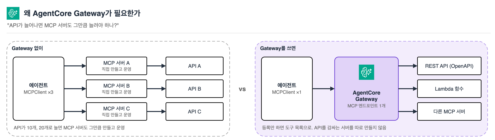
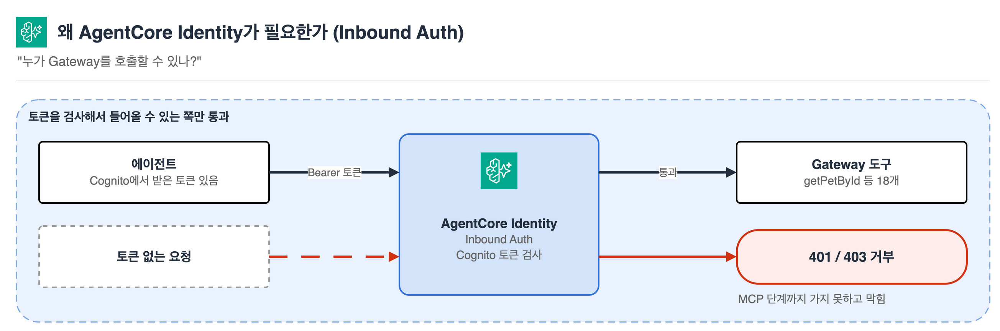
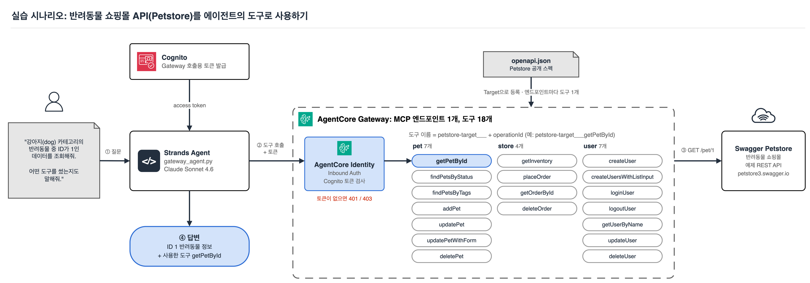
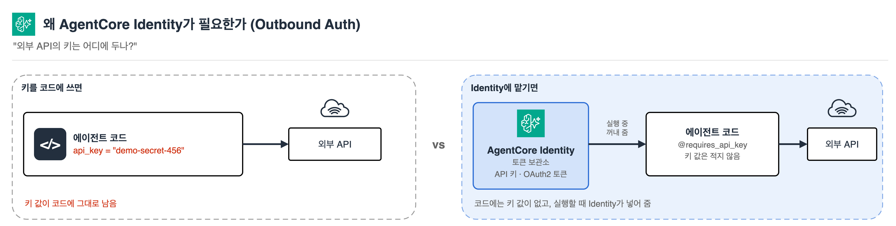

# 9. 외부 API 연동과 접근 제어 (AgentCore Gateway & Identity)

<p align="center"><a href="README.md">한국어</a> | <a href="../../en/09-agentcore-gateway-identity/README.md">English</a></p>

## 목차

- [AgentCore Gateway란?](#agentcore-gateway란)
- [AgentCore Identity란?](#agentcore-identity란)
- [0. 전체 흐름 미리 보기](#0-전체-흐름-미리-보기)
- [1. Gateway 세우기 (Cognito + IAM + Gateway + Target)](#1-gateway-세우기-cognito--iam--gateway--target)
- [2. 토큰 발급받아 에이전트에서 Gateway 호출하기](#2-토큰-발급받아-에이전트에서-gateway-호출하기)
- [3. (선택) Outbound Auth: 외부 API에 안전하게 인증하기](#3-선택-outbound-auth-외부-api에-안전하게-인증하기)
- [리소스 정리](#리소스-정리)
- [트러블슈팅](#트러블슈팅)

---

이번 실습에서는 지금까지 만든 에이전트가 **외부 API를 MCP 도구로 호출**하고, 그 호출을 **누가 할 수 있는지 통제**하는 방법을 학습합니다. [Amazon Bedrock AgentCore Gateway](https://docs.aws.amazon.com/bedrock-agentcore/latest/devguide/gateway.html)로 기존 REST API를 MCP 도구로 노출하고, [AgentCore Identity](https://docs.aws.amazon.com/bedrock-agentcore/latest/devguide/identity.html)로 그 Gateway를 호출할 수 있는 대상을 Cognito 기반 OAuth2 토큰으로 제한합니다.

실습 방식은 다른 챕터와 같습니다. `labs/` 폴더의 빈 파일에 직접 코드를 작성하고, `completed/` 폴더에는 정답 코드가 들어 있습니다.

> [!NOTE]
> **사전 준비**
> - [00-setup](../00-setup/README.md)에 따라 환경 구성 및 uv 환경 활성화
> - 이전 챕터와 동일하게 `us-west-2` 리전의 Amazon Bedrock 모델(Claude) 액세스
> - IAM(역할 생성), Cognito(사용자 풀 생성), Bedrock AgentCore(Gateway 생성)에 대한 권한
> - 이 챕터는 **과금되는 AWS 리소스**(AgentCore Gateway, Cognito User Pool)를 생성합니다. 둘 다 소액이지만, 실습 후 [리소스 정리](#리소스-정리)를 반드시 수행하세요.

**이번 챕터에서 배우는 내용**

- AgentCore Gateway가 REST API/Lambda/다른 MCP 서버를 MCP 도구로 바꿔주는 원리
- AgentCore Identity의 Inbound Auth(누가 Gateway를 호출하는지)와 Outbound Auth(에이전트가 외부 서비스에 어떻게 인증하는지)의 역할 구분
- Cognito User Pool로 Gateway의 Inbound Auth(Custom JWT Authorizer)를 구성하는 방법
- boto3로 Gateway를 만들고, 공개 OpenAPI 스펙(Swagger Petstore)을 Target으로 등록하는 방법
- 발급받은 OAuth2 토큰으로 Strands 에이전트가 Gateway의 MCP 도구를 호출하는 방법
- (선택) Outbound Auth용 Credential Provider(API Key, OAuth2)의 개념과 코드 패턴

**예상 소요 시간:** 약 25분

## 이번 챕터의 파일

| 파일 | 용도 |
|---|---|
| `labs/setup_gateway.py` | (빈 파일) 직접 작성: Cognito + IAM 역할 + Gateway + Petstore OpenAPI Target 생성 |
| `labs/gateway_agent.py` | (빈 파일) 직접 작성: 토큰 발급 + Gateway를 도구로 쓰는 Strands 에이전트 |
| `labs/outbound_auth_demo.py` | (빈 파일, 선택) 직접 작성: Identity Outbound Auth(API Key) 데모 |
| `labs/cleanup.py` | (빈 파일) 직접 작성: 리소스 정리 스크립트 |
| `completed/*.py` | 정답 코드 (영문 주석/출력문) |

---

## AgentCore Gateway란?

Gateway는 REST API(OpenAPI 스펙), Lambda 함수, 다른 MCP 서버를 **MCP 도구로 변환해주는 완전관리형 서비스**입니다. [1-3 챕터](../01-single-agent/README.md)에서 봤듯 MCP Client는 Server 하나당 하나씩 붙는 게 기본 패턴인데, 회사에 API가 10개, 20개로 늘어나면 그만큼의 MCP Server를 각각 만들고 운영해야 합니다. Gateway는 그 여러 백엔드를 등록만 하면 하나의 MCP 엔드포인트로 묶어서 내보내 줍니다. 에이전트 쪽 Client는 Gateway 엔드포인트 하나에만 붙으면, 그 뒤에 등록된 모든 백엔드의 기능을 Tool 목록으로 받습니다.

이번 실습에서는 공개된 Swagger Petstore(반려동물 쇼핑몰 예제 API)의 OpenAPI 스펙을 Target으로 등록합니다. 등록하는 순간 그 API의 각 엔드포인트(`getPetById`, `addPet` 등)가 각각 하나의 MCP Tool로 자동 매핑됩니다. 새 코드를 짜거나 API를 감싸는 서버를 따로 만들 필요가 없습니다.



## AgentCore Identity란?

Identity는 두 가지를 책임집니다.

- **Inbound Auth**: Gateway나 Runtime을 "누가 호출할 수 있는지" 검증합니다. 이번 실습에서는 Cognito User Pool이 발급한 JWT 토큰을 가진 클라이언트만 Gateway를 호출하게 만듭니다.
- **Outbound Auth**: 에이전트가 "외부 서비스에 어떻게 인증해서 접근하는지"를 관리합니다. API 키나 OAuth2 토큰을 에이전트 코드에 직접 넣지 않고, Identity의 토큰 보관소(Token Vault)에 등록해두면 에이전트가 실행 중에 안전하게 꺼내 씁니다.



이번 실습의 1~2단계는 Inbound Auth를 직접 구성하고 호출까지 해봅니다. Outbound Auth는 3단계에서 직접 실행해봅니다.

## 0. 전체 흐름 미리 보기



```
Cognito User Pool (Inbound Auth 발급자)
        │ discovery URL, client_id, client_secret
        ▼
Gateway 생성 (authorizerType=CUSTOM_JWT로 위 Cognito 연결)
        │
        ▼
Gateway에 OpenAPI Target 등록 (Petstore 스펙 -> MCP Tool로 자동 변환)
        │
        ▼
클라이언트가 Cognito에서 OAuth2 액세스 토큰 발급 (client_credentials)
        │
        ▼
Strands 에이전트가 그 토큰을 Authorization 헤더에 담아 Gateway의 MCP 도구 호출
```

1단계가 "Gateway를 세우는 쪽", 2단계가 "그 Gateway를 쓰는 쪽"입니다.

## 1. Gateway 세우기 (Cognito + IAM + Gateway + Target)

Cognito 설정, IAM 역할 생성, Gateway 생성, OpenAPI Target 등록까지 한 스크립트에서 순서대로 진행합니다.

**1-1.** `labs/setup_gateway.py` 파일을 엽니다.

**1-2.** 필요한 라이브러리를 import하고, 상수를 정의합니다.

```py
import json
import secrets
import string
import time

import boto3
import requests

REGION = "us-west-2"
POOL_NAME = "agentcore-workshop-gateway-pool"
RESOURCE_SERVER_ID = "gateway"
SCOPE_NAME = "invoke"
APP_CLIENT_NAME = "agentcore-workshop-gateway-client"
ROLE_NAME = "agentcore-workshop-gateway-role"
GATEWAY_NAME = "petstore-gateway"
TARGET_NAME = "petstore-target"
PETSTORE_OPENAPI_URL = "https://petstore3.swagger.io/api/v3/openapi.json"
CONFIG_FILE = "gateway_config.json"
```

**1-3.** Cognito 리소스를 만드는 함수를 작성합니다. User Pool, Resource Server(스코프 `gateway/invoke` 정의), App Client(`client_credentials` 흐름), 토큰 엔드포인트용 도메인까지 네 가지를 순서대로 만듭니다. 이 설정이 "누가 Gateway를 호출할 수 있는지"(Inbound Auth)를 결정합니다. 같은 이름의 User Pool이 이미 있으면(스크립트를 다시 실행한 경우) 지우고 새로 만들어, 아래에서 받는 client secret이 항상 최신 상태가 되게 합니다.

```py
def random_suffix(n: int = 6) -> str:
    return "".join(secrets.choice(string.ascii_lowercase + string.digits) for _ in range(n))


def setup_cognito() -> dict:
    print("1) Setting up Cognito (User Pool, Resource Server, App Client, domain)...")
    cognito = boto3.client("cognito-idp", region_name=REGION)

    # Re-running this script should not pile up duplicate pools: reuse one if it exists.
    existing = [p for p in cognito.list_user_pools(MaxResults=60)["UserPools"] if p["Name"] == POOL_NAME]
    for pool in existing:  # start clean so the client secret below is fresh
        old_domain = cognito.describe_user_pool(UserPoolId=pool["Id"])["UserPool"].get("Domain")
        if old_domain:
            cognito.delete_user_pool_domain(Domain=old_domain, UserPoolId=pool["Id"])
        cognito.delete_user_pool(UserPoolId=pool["Id"])
    user_pool_id = cognito.create_user_pool(PoolName=POOL_NAME)["UserPool"]["Id"]

    cognito.create_resource_server(
        UserPoolId=user_pool_id,
        Identifier=RESOURCE_SERVER_ID,
        Name="AgentCore Gateway Resource Server",
        Scopes=[{"ScopeName": SCOPE_NAME, "ScopeDescription": "Invoke gateway tools"}],
    )
    full_scope = f"{RESOURCE_SERVER_ID}/{SCOPE_NAME}"

    app_client = cognito.create_user_pool_client(
        UserPoolId=user_pool_id,
        ClientName=APP_CLIENT_NAME,
        GenerateSecret=True,
        AllowedOAuthFlows=["client_credentials"],
        AllowedOAuthScopes=[full_scope],
        AllowedOAuthFlowsUserPoolClient=True,
        SupportedIdentityProviders=["COGNITO"],
    )

    domain = f"agentcore-ws-{random_suffix()}"
    cognito.create_user_pool_domain(Domain=domain, UserPoolId=user_pool_id)

    return {
        "user_pool_id": user_pool_id,
        "client_id": app_client["UserPoolClient"]["ClientId"],
        "client_secret": app_client["UserPoolClient"]["ClientSecret"],
        "domain": domain,
        "discovery_url": (
            f"https://cognito-idp.{REGION}.amazonaws.com/{user_pool_id}"
            "/.well-known/openid-configuration"
        ),
        "token_endpoint": f"https://{domain}.auth.{REGION}.amazoncognito.com/oauth2/token",
        "scope": full_scope,
    }
```

> **`client_credentials` 흐름이 뭔가요?**
> 사람이 로그인 화면에서 아이디/비밀번호를 입력하는 흐름(Authorization Code)과 달리, 서버나 스크립트가 자기 자신의 신분(client_id + client_secret)만으로 토큰을 받는 M2M(machine-to-machine) 흐름입니다. 이번 실습의 에이전트는 "특정 사용자를 대신"하는 게 아니라 "Gateway를 호출할 자격이 있는 클라이언트"임을 증명하기만 하면 되므로 이 흐름을 씁니다.

**1-4.** Gateway가 Petstore API를 호출하고 로그를 남길 때 쓸 IAM 역할을 만드는 함수를 작성합니다.

```py
def setup_gateway_role() -> str:
    print("2) Creating the IAM role the Gateway will use...")
    iam = boto3.client("iam", region_name=REGION)
    account_id = boto3.client("sts", region_name=REGION).get_caller_identity()["Account"]

    trust_policy = {
        "Version": "2012-10-17",
        "Statement": [{
            "Effect": "Allow",
            "Principal": {"Service": "bedrock-agentcore.amazonaws.com"},
            "Action": "sts:AssumeRole",
            "Condition": {"StringEquals": {"aws:SourceAccount": account_id}},
        }],
    }
    # 실습용 최소 권한입니다. 운영 환경에서는 리소스를 더 구체적으로 좁혀야 합니다.
    permissions_policy = {
        "Version": "2012-10-17",
        "Statement": [{
            "Effect": "Allow",
            "Action": [
                "bedrock-agentcore:*",
                "secretsmanager:GetSecretValue",
                "logs:CreateLogGroup",
                "logs:CreateLogStream",
                "logs:PutLogEvents",
            ],
            "Resource": "*",
        }],
    }

    try:
        role_arn = iam.create_role(
            RoleName=ROLE_NAME,
            AssumeRolePolicyDocument=json.dumps(trust_policy),
            Description="AgentCore Gateway workshop execution role",
        )["Role"]["Arn"]
    except iam.exceptions.EntityAlreadyExistsException:
        role_arn = iam.get_role(RoleName=ROLE_NAME)["Role"]["Arn"]

    iam.put_role_policy(
        RoleName=ROLE_NAME,
        PolicyName="agentcore-workshop-gateway-policy",
        PolicyDocument=json.dumps(permissions_policy),
    )
    time.sleep(10)  # 역할 전파 대기
    return role_arn
```

**1-5.** Gateway와 Target 생성은 즉시 끝나지 않고 `CREATING` 상태를 거쳐 `READY`가 됩니다. 상태를 확인할 때까지 기다리는 공용 함수를 하나만 작성해서, Gateway와 Target 양쪽에 재사용합니다.

```py
def wait_until(describe_fn) -> dict:
    """describe_fn()의 status 필드가 READY가 될 때까지 반복 확인합니다."""
    while True:
        resp = describe_fn()
        status = resp["status"]
        if status == "READY":
            return resp
        if status in ("FAILED", "UPDATE_UNSUCCESSFUL", "SYNCHRONIZE_UNSUCCESSFUL"):
            raise RuntimeError(f"Failed with status {status}: {resp.get('statusReasons')}")
        time.sleep(5)
```

**1-6.** Gateway를 생성하고, Petstore의 공개 OpenAPI 스펙을 Target으로 등록하는 함수를 작성합니다.

- `authorizerType="CUSTOM_JWT"`와 `authorizerConfiguration`에 1-3에서 만든 Cognito 정보를 그대로 넣습니다. "Cognito가 발급한, 이 client_id를 가진 토큰만 통과시킨다"는 Inbound Auth 규칙입니다. (`allowedScopes`로 scope까지 추가 검증할 수도 있지만, 이 필드는 비교적 최근에 추가되어 botocore 버전에 따라 지원하지 않을 수 있어 이번 실습에서는 뺐습니다.)
- Petstore의 공개 스펙은 그대로 쓸 수 없고 두 가지를 손질해야 합니다. `servers`가 `/api/v3`처럼 상대 경로인데 Gateway는 절대 HTTPS URL을 요구하고, `/pet/{petId}/uploadImage` 엔드포인트가 Gateway의 OpenAPI 임포터가 지원하지 않는 `application/octet-stream` 요청 바디를 씁니다.
- Gateway와 Target은 이름이 계정 안에서 고유해야 합니다. 스크립트를 다시 실행하면 `ConflictException`이 나므로, 그때는 기존 것을 찾아 재사용하고 Gateway만 새 Cognito 설정으로 갱신합니다. 중간에 실패해도 그냥 다시 실행하면 됩니다.
- `credentialProviderConfigurations`는 지정하지 않습니다. `GATEWAY_IAM_ROLE`은 Gateway가 SigV4로 서명해서 호출하는 AWS 서비스용 옵션이라, 인증이 전혀 필요 없는 Petstore 같은 공개 API에는 이 파라미터를 생략하면 됩니다.

```py
def setup_gateway_and_target(cognito_info: dict, role_arn: str) -> dict:
    client = boto3.client("bedrock-agentcore-control", region_name=REGION)

    print("3) Creating the Gateway (Inbound Auth: Cognito JWT) and waiting for it to be READY...")
    authorizer = {
        "customJWTAuthorizer": {
            "discoveryUrl": cognito_info["discovery_url"],
            "allowedClients": [cognito_info["client_id"]],
        }
    }
    try:
        gateway_id = client.create_gateway(
            name=GATEWAY_NAME,
            roleArn=role_arn,
            protocolType="MCP",
            authorizerType="CUSTOM_JWT",
            authorizerConfiguration=authorizer,
            description="Workshop: Gateway exposing the Petstore OpenAPI as MCP tools",
        )["gatewayId"]
    except client.exceptions.ConflictException:
        # Left over from an earlier run: reuse it, but point it at the Cognito pool we just made.
        gateway_id = next(g["gatewayId"] for g in client.list_gateways()["items"] if g["name"] == GATEWAY_NAME)
        print(f"   Gateway '{GATEWAY_NAME}' already exists ({gateway_id}), reusing it.")
        wait_until(lambda: client.get_gateway(gatewayIdentifier=gateway_id))
        client.update_gateway(
            gatewayIdentifier=gateway_id,
            name=GATEWAY_NAME,
            roleArn=role_arn,
            protocolType="MCP",
            authorizerType="CUSTOM_JWT",
            authorizerConfiguration=authorizer,
        )
    gateway_url = wait_until(lambda: client.get_gateway(gatewayIdentifier=gateway_id))["gatewayUrl"]

    print("4) Registering the Petstore OpenAPI as a Target and waiting for it to be READY...")
    spec = requests.get(PETSTORE_OPENAPI_URL, timeout=30).json()
    spec["servers"] = [{"url": "https://petstore3.swagger.io/api/v3"}]
    spec["paths"].pop("/pet/{petId}/uploadImage", None)

    try:
        target_id = client.create_gateway_target(
            gatewayIdentifier=gateway_id,
            name=TARGET_NAME,
            targetConfiguration={"mcp": {"openApiSchema": {"inlinePayload": json.dumps(spec)}}},
            description="Public Swagger Petstore API",
        )["targetId"]
    except client.exceptions.ConflictException:
        target_id = next(
            tg["targetId"]
            for tg in client.list_gateway_targets(gatewayIdentifier=gateway_id)["items"]
            if tg["name"] == TARGET_NAME
        )
        print(f"   Target '{TARGET_NAME}' already exists ({target_id}), reusing it.")
    wait_until(lambda: client.get_gateway_target(gatewayIdentifier=gateway_id, targetId=target_id))

    return {"gateway_id": gateway_id, "gateway_url": gateway_url, "target_id": target_id}
```

**1-7.** 세 함수를 순서대로 실행하고, 결과를 `gateway_config.json`에 저장하는 진입점을 작성합니다. 이 파일은 다음 단계의 에이전트와 리소스 정리 스크립트가 공유해서 읽습니다.

```py
if __name__ == "__main__":
    cognito_info = setup_cognito()
    role_arn = setup_gateway_role()
    gateway_info = setup_gateway_and_target(cognito_info, role_arn)

    config = {**cognito_info, "role_arn": role_arn, "region": REGION, **gateway_info}
    with open(CONFIG_FILE, "w") as f:
        json.dump(config, f, indent=2)

    print(f"\nDone! Gateway URL: {config['gateway_url']}")
```

**1-8.** 터미널에서 실행합니다.

```bash
cd 09-agentcore-gateway-identity/labs
uv run setup_gateway.py
cd -
```

4단계 로그가 순서대로 출력되고 마지막에 `https://<gateway-id>.gateway.bedrock-agentcore.us-west-2.amazonaws.com/mcp` 형태의 Gateway URL이 나오면 성공입니다. 보통 1~2분 정도 걸립니다.

<details>
<summary>전체 코드 확인하기 (setup_gateway.py)</summary>

`09-agentcore-gateway-identity/completed/setup_gateway.py` 파일에서 전체 코드를 확인할 수 있습니다.
</details>

## 2. 토큰 발급받아 에이전트에서 Gateway 호출하기

**2-1.** `labs/gateway_agent.py` 파일을 엽니다.

**2-2.** 라이브러리를 import하고, 설정 파일을 읽습니다.

```py
import json

import requests
from mcp.client.streamable_http import streamablehttp_client
from strands import Agent
from strands.models import BedrockModel
from strands.tools.mcp import MCPClient

CONFIG_FILE = "gateway_config.json"

with open(CONFIG_FILE) as f:
    config = json.load(f)
```

**2-3.** Cognito 토큰 엔드포인트로 `client_credentials` 요청을 보내는 함수를 작성합니다.

```py
def get_access_token() -> str:
    """Cognito에서 OAuth2 액세스 토큰을 받아옵니다 (client_credentials 흐름).
    이 토큰이 Gateway 호출 시 Authorization 헤더에 들어갑니다."""
    response = requests.post(
        config["token_endpoint"],
        data={
            "grant_type": "client_credentials",
            "client_id": config["client_id"],
            "client_secret": config["client_secret"],
            "scope": config["scope"],
        },
        headers={"Content-Type": "application/x-www-form-urlencoded"},
        timeout=30,
    )
    response.raise_for_status()
    return response.json()["access_token"]
```

**2-4.** [1-3 챕터](../01-single-agent/README.md)에서 로컬 MCP 서버를 `stdio_client`로 연결했던 것과 구조는 똑같고, 연결 대상만 로컬 프로세스가 아니라 원격 Gateway URL로 바뀝니다. `streamablehttp_client`의 `headers`에 발급받은 토큰을 `Authorization: Bearer <토큰>` 형태로 넣는 부분이 Inbound Auth를 통과하는 지점입니다.

```py
access_token = get_access_token()

gateway_mcp_client = MCPClient(lambda: streamablehttp_client(
    config["gateway_url"],
    headers={"Authorization": f"Bearer {access_token}"},
))

if __name__ == "__main__":
    user_input = (
        "강아지(dog) 카테고리의 반려동물 중 ID가 1인 데이터를 조회해줘. "
        "어떤 도구를 썼는지도 말해줘."
    )

    bedrock_model = BedrockModel(model_id="us.anthropic.claude-sonnet-4-6")

    agent = Agent(model=bedrock_model, tools=[gateway_mcp_client])
    response = agent(user_input)
```

**2-5.** 실행합니다.

```bash
cd 09-agentcore-gateway-identity/labs
uv run gateway_agent.py
cd -
```

에이전트가 Gateway에서 받아온 도구 목록 중 하나를 선택해서 호출하고, 그 결과를 바탕으로 답변하는 것을 확인할 수 있습니다. 도구 이름은 `petstore-target___getPetById`처럼 `<Target 이름>___<operationId>` 형태로 자동 생성됩니다. Target을 여러 개 등록해도 이 접두사로 어느 백엔드의 도구인지 구분할 수 있습니다.

<details>
<summary>토큰 없이 호출하면 어떻게 되나요?</summary>

`headers`를 빼고 실행해보면 `401`이나 `403` 오류가 돌아옵니다. Gateway가 `authorizerType=CUSTOM_JWT`로 설정되어 있어서, 유효한 토큰이 없는 요청은 MCP 프로토콜 단계까지 가지도 못하고 거부됩니다. 바로 이게 Inbound Auth가 실제로 막아주는 지점입니다.
</details>

<details>
<summary>전체 코드 확인하기 (gateway_agent.py)</summary>

`09-agentcore-gateway-identity/completed/gateway_agent.py` 파일에서 전체 코드를 확인할 수 있습니다.
</details>

축하합니다! Gateway로 외부 API를 MCP 도구로 노출하고, Cognito 기반 토큰으로 그 호출을 통제하는 것까지 확인했습니다.

## 3. (선택) Outbound Auth: 외부 API에 안전하게 인증하기

> [!NOTE]
> 이 섹션은 **선택 실습**입니다. 핵심 워크샵 흐름에는 영향을 주지 않으며, 건너뛰고 다음 챕터로 이동해도 됩니다.

지금까지는 Petstore가 인증이 필요 없는 공개 API라서 `GATEWAY_IAM_ROLE`만으로 충분했습니다. 실제로는 Target으로 등록하려는 API가 자체 API 키나 OAuth2 토큰을 요구하는 경우가 많습니다. 이때 그 자격 증명을 코드에 하드코딩하지 않고 Identity의 **Credential Provider**에 등록해두는 것이 Outbound Auth입니다.



1~2단계가 "누가 Gateway를 호출할 수 있는지"(Inbound Auth)를 Gateway 설정으로 다뤘다면, 이번 단계는 "에이전트가 외부 서비스에 어떻게 인증하는지"(Outbound Auth)를 `bedrock_agentcore.identity` 라이브러리로 직접 다뤄봅니다.

**4-1.** `labs/outbound_auth_demo.py` 파일을 엽니다.

**4-2.** 라이브러리를 import하고 상수를 정의합니다. `requires_api_key`가 내부적으로 참조하는 `AWS_REGION` 환경변수를, 지금까지 리소스를 만든 리전으로 명시적으로 맞춰둡니다.

```py
import json
import os

import boto3
from bedrock_agentcore.identity import requires_api_key

REGION = "us-west-2"
PROVIDER_NAME = "workshop-weather-api-key-provider"
WORKLOAD_IDENTITY_NAME = "workshop-outbound-auth-identity"

# requires_api_key()는 AWS_REGION 환경변수를 보고 어느 리전을 호출할지 정합니다.
# 쉘에 다른 리전이 이미 설정되어 있으면, 리소스가 있는 리전과 안 맞아서
# "Workload Identity does not belong to caller account" 같은 엉뚱한 에러가 납니다.
os.environ["AWS_REGION"] = REGION
```

**4-3.** API 키를 Identity에 등록하고, 그 키를 꺼내 올 때 쓰는 Workload Identity를 미리 만들어두는 함수를 작성합니다. 둘 다 이름이 계정 안에서 고유해야 해서, 다시 실행하면 `already exists` 에러가 납니다. 그 경우 기존 것을 그대로 재사용합니다.

> **Workload Identity를 왜 미리 만드나요?**
> `requires_api_key` 데코레이터는 Workload Identity가 없으면 자동으로 하나 만들어주는 기능이 있습니다. 다만 이 자동 생성 경로는 AgentCore Runtime 밖(지금처럼 로컬에서 직접 실행하는 경우)에서는 아직 지원되지 않습니다. 그래서 control-plane API로 미리 만들어두고 그 이름을 `.agentcore.json`에 저장해두면, 데코레이터가 그 설정을 그대로 읽어서 씁니다.

```py
def register_demo_credential() -> None:
    client = boto3.client("bedrock-agentcore-control", region_name=REGION)

    print("1) Registering a sample API key with Identity...")
    try:
        client.create_api_key_credential_provider(name=PROVIDER_NAME, apiKey="demo-secret-456")
    except client.exceptions.ValidationException as e:
        if "already exists" not in str(e):
            raise
        print(f"   Provider '{PROVIDER_NAME}' already exists, reusing it.")

    print("2) Pre-provisioning the workload identity...")
    try:
        client.create_workload_identity(name=WORKLOAD_IDENTITY_NAME, allowedResourceOauth2ReturnUrls=[])
    except (client.exceptions.ConflictException, client.exceptions.ValidationException) as e:
        if "already exists" not in str(e).lower():
            raise
        print(f"   Workload identity '{WORKLOAD_IDENTITY_NAME}' already exists, reusing it.")

    with open(".agentcore.json", "w") as f:
        json.dump(
            {"workload_identity_name": WORKLOAD_IDENTITY_NAME, "user_id": "workshop-user"},
            f,
            indent=2,
        )
    print("Done.")
```

**4-4.** `requires_api_key` 데코레이터로 그 키를 꺼내 쓰는 함수를 작성합니다. 함수 코드 어디에도 실제 키 값이 적혀 있지 않다는 점을 눈으로 확인해보세요.

```py
@requires_api_key(provider_name=PROVIDER_NAME)
def call_weather_api(*, api_key: str) -> None:
    """실제 외부 날씨 API를 호출하는 자리를 대신합니다.
    이 함수 어디에도 키 값이 적혀 있지 않고, requires_api_key가
    Identity의 토큰 보관소에서 꺼내서 넣어줍니다."""
    print(f"Calling the weather API with a key that starts with '{api_key[:4]}...'")
    print("(This is a demo -- no real external API is actually called.)")


if __name__ == "__main__":
    register_demo_credential()
    call_weather_api()
```

**4-5.** 실행합니다.

```bash
cd 09-agentcore-gateway-identity/labs
uv run outbound_auth_demo.py
cd -
```

`Calling the weather API with a key that starts with 'demo...'`처럼 키의 앞 네 글자만 보이는 로그가 출력되면 성공입니다. `register_demo_credential()`에서 등록해둔 키(`demo-secret-456`)가 코드에 다시 적힌 적 없이, Identity의 토큰 보관소에서 그대로 꺼내진 겁니다.

<details>
<summary>전체 코드 확인하기 (outbound_auth_demo.py)</summary>

`09-agentcore-gateway-identity/completed/outbound_auth_demo.py` 파일에서 전체 코드를 확인할 수 있습니다.
</details>

**API 키를 Gateway Target에 바로 연결하고 싶다면**

지금은 에이전트 코드에서 직접 키를 꺼내 썼지만, Target으로 등록하려는 API 자체가 API 키를 요구한다면 Gateway가 대신 그 키를 꺼내서 헤더에 넣어주게 만들 수도 있습니다. `create_gateway_target` 호출의 `credentialProviderConfigurations`에 아래를 추가하면 됩니다.

```py
import boto3

client = boto3.client("bedrock-agentcore-control", region_name="us-west-2")

response = client.create_api_key_credential_provider(
    name="my-weather-api-key-provider",
    apiKey="<발급받은 API 키>",
)
provider_arn = response["credentialProviderArn"]

# create_gateway_target 호출 시 credentialProviderConfigurations에 아래를 추가합니다
credential_config = {
    "credentialProviderType": "API_KEY",
    "credentialProvider": {
        "apiKeyCredentialProvider": {
            "providerArn": provider_arn,
            "credentialParameterName": "x-api-key",
            "credentialLocation": "HEADER",
        }
    },
}
```

**사용자를 대신해서 OAuth2 인증이 필요한 경우 (3-legged OAuth)**

이번 실습의 Cognito 토큰은 "에이전트 자신"의 자격을 증명하는 M2M 토큰이었습니다. 반면 "이 사용자를 대신해서 캘린더에 일정을 등록해줘" 같은 작업은 그 사용자 본인이 외부 서비스에 로그인해서 동의해야 합니다. `bedrock_agentcore.identity`의 `requires_access_token` 데코레이터가 이 흐름을 처리합니다.

```py
from bedrock_agentcore.identity import requires_access_token

@requires_access_token(
    provider_name="MyOAuth2Provider",   # create_oauth2_credential_provider로 미리 등록
    scopes=["openid"],
    auth_flow="USER_FEDERATION",        # 사용자 동의가 필요한 3-legged OAuth
    on_auth_url=handle_auth_url,        # 사용자에게 로그인 URL을 보여주는 콜백
)
async def call_external_api(*, access_token: str):
    # access_token으로 사용자를 대신해 외부 API 호출
    ...
```

이 흐름은 사용자의 브라우저 리디렉션과 콜백 URL이 필요해서, AgentCore Runtime에 배포된 상태에서 쓰는 패턴입니다. 이번 챕터에서는 코드 패턴만 소개하고 직접 실행하지는 않습니다. 전체 예제는 [AgentCore Identity 공식 가이드](https://docs.aws.amazon.com/bedrock-agentcore/latest/devguide/identity-getting-started-cognito.html)에서 끝까지 따라해볼 수 있습니다.

## 리소스 정리

이 챕터에서 만든 리소스는 Gateway Target, Gateway, Cognito User Pool, IAM 역할, 그리고 3단계를 진행했다면 Outbound Auth 데모의 Credential Provider와 Workload Identity입니다. `labs/cleanup.py`에 아래 코드를 작성하고 실행하면 순서대로 정리됩니다.

```py
import json
import os
import time

import boto3

CONFIG_FILE = "gateway_config.json"
OUTBOUND_AUTH_REGION = "us-west-2"
OUTBOUND_AUTH_PROVIDER_NAME = "workshop-weather-api-key-provider"
OUTBOUND_AUTH_WORKLOAD_IDENTITY_NAME = "workshop-outbound-auth-identity"


def cleanup_gateway_resources() -> None:
    if not os.path.exists(CONFIG_FILE):
        print(f"{CONFIG_FILE} not found, skipping Gateway/Cognito/IAM cleanup.")
        return

    with open(CONFIG_FILE) as f:
        config = json.load(f)

    agentcore = boto3.client("bedrock-agentcore-control", region_name=config["region"])
    cognito = boto3.client("cognito-idp", region_name=config["region"])
    iam = boto3.client("iam", region_name=config["region"])

    if "target_id" in config:
        print("Deleting Gateway Target...")
        agentcore.delete_gateway_target(
            gatewayIdentifier=config["gateway_id"], targetId=config["target_id"]
        )
        time.sleep(5)

    if "gateway_id" in config:
        print("Deleting Gateway...")
        agentcore.delete_gateway(gatewayIdentifier=config["gateway_id"])

    print("Deleting Cognito resources (deleting the User Pool also removes the App Client/Resource Server)...")
    cognito.delete_user_pool_domain(Domain=config["domain"], UserPoolId=config["user_pool_id"])
    cognito.delete_user_pool(UserPoolId=config["user_pool_id"])

    print("Deleting IAM role...")
    role_name = config["role_arn"].split("/")[-1]
    try:
        iam.delete_role_policy(RoleName=role_name, PolicyName="agentcore-workshop-gateway-policy")
    except iam.exceptions.NoSuchEntityException:
        pass
    iam.delete_role(RoleName=role_name)


def cleanup_outbound_auth_demo() -> None:
    client = boto3.client("bedrock-agentcore-control", region_name=OUTBOUND_AUTH_REGION)

    print("Deleting Outbound Auth demo credential provider...")
    try:
        client.delete_api_key_credential_provider(name=OUTBOUND_AUTH_PROVIDER_NAME)
    except client.exceptions.ResourceNotFoundException:
        pass

    print("Deleting Outbound Auth demo workload identity...")
    try:
        client.delete_workload_identity(name=OUTBOUND_AUTH_WORKLOAD_IDENTITY_NAME)
    except client.exceptions.ResourceNotFoundException:
        pass

    if os.path.exists(".agentcore.json"):
        os.remove(".agentcore.json")


def main() -> None:
    cleanup_gateway_resources()
    cleanup_outbound_auth_demo()
    print("Cleanup complete")


if __name__ == "__main__":
    main()
```

```bash
cd 09-agentcore-gateway-identity/labs
uv run cleanup.py
cd -
```

삭제 전에 `gateway_config.json`이 이번 실습에서 만든 리소스를 가리키는 게 맞는지 한 번 확인하세요. 3단계를 건너뛰었다면 `gateway_config.json`이 없어도, Outbound Auth 쪽 삭제는 리소스가 없으면 조용히 넘어가므로 그냥 실행해도 안전합니다.

## 트러블슈팅

| 증상 | 원인 / 해결 |
|---|---|
| `create_gateway` 호출 시 `AccessDeniedException` | 방금 만든 IAM 역할이 아직 전파되지 않았을 가능성이 큽니다. 1분 정도 기다렸다가 `setup_gateway.py`를 다시 실행하세요. |
| Gateway 상태가 `FAILED`로 멈춤 | `get_gateway`의 `statusReasons` 필드에 원인이 나옵니다. 대부분 `roleArn`에 필요한 권한이 빠진 경우입니다. |
| `gateway_agent.py` 실행 시 `401 Unauthorized` | 토큰이 만료되었거나(Cognito 토큰은 기본 1시간) `allowedClients`가 Gateway 설정과 다릅니다. `gateway_agent.py`는 실행할 때마다 새 토큰을 받아오므로 다시 실행해보세요. |
| `create_gateway` 호출 시 `ParamValidationError: Unknown parameter ... allowedScopes` | botocore 버전이 오래되어 `allowedScopes` 필드를 모르는 경우입니다. 이 가이드의 코드에는 이미 `allowedScopes`가 빠져 있으니, `labs/setup_gateway.py`에 다른 버전을 붙여넣지 않았는지 확인하세요. |
| `create_gateway_target` 호출 시 OpenAPI 스펙 관련 오류 | Petstore 서버가 일시적으로 응답하지 않을 수 있습니다. `requests.get(PETSTORE_OPENAPI_URL)`을 단독으로 실행해 스펙이 정상적으로 받아지는지 먼저 확인하세요. |
| 모든 스크립트에서 `FileNotFoundError: gateway_config.json` | 스크립트를 다른 위치에서 실행했을 가능성이 큽니다. 다른 챕터와 동일하게 `labs/` 디렉토리에서 실행하세요. |
| `outbound_auth_demo.py` 실행 시 `AccessDeniedException: ... can't call Identity endpoint directly` | `requires_api_key`가 Workload Identity를 자동으로 만들려고 할 때 나는 에러입니다. AgentCore Runtime 밖에서는 이 자동 생성 경로를 아직 못 씁니다. `register_demo_credential()`로 미리 만들어두고 `.agentcore.json`에 저장해두는 지금 코드처럼 우회해야 합니다. |
| `outbound_auth_demo.py` 실행 시 `Workload Identity does not belong to caller account` | 쉘에 `AWS_REGION`이나 `AWS_DEFAULT_REGION`이 다른 리전으로 이미 설정되어 있을 가능성이 큽니다. `requires_api_key`는 `AWS_REGION`을 보고 호출 리전을 정하는데, 리소스를 만든 리전과 다르면 이런 에러가 납니다. `echo $AWS_REGION`으로 확인하고, 코드의 `os.environ["AWS_REGION"] = REGION`이 실제로 덮어쓰고 있는지 확인하세요. |

---

## 참고 자료

- [AgentCore Gateway 개발자 가이드](https://docs.aws.amazon.com/bedrock-agentcore/latest/devguide/gateway.html)
- [AgentCore Gateway Quick Start](https://docs.aws.amazon.com/bedrock-agentcore/latest/devguide/gateway-quick-start.html)
- [AgentCore Identity 개발자 가이드](https://docs.aws.amazon.com/bedrock-agentcore/latest/devguide/identity.html)
- [AgentCore Identity: 인증된 에이전트 만들기](https://docs.aws.amazon.com/bedrock-agentcore/latest/devguide/identity-getting-started-cognito.html)
- [boto3 bedrock-agentcore-control API 레퍼런스](https://docs.aws.amazon.com/boto3/latest/reference/services/bedrock-agentcore-control.html)
- [Swagger Petstore (OpenAPI 3.0 샘플)](https://petstore3.swagger.io/)
